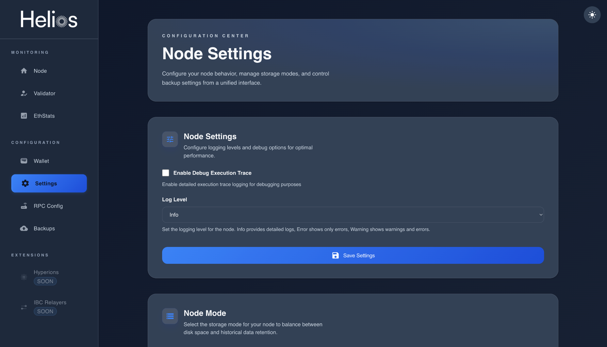
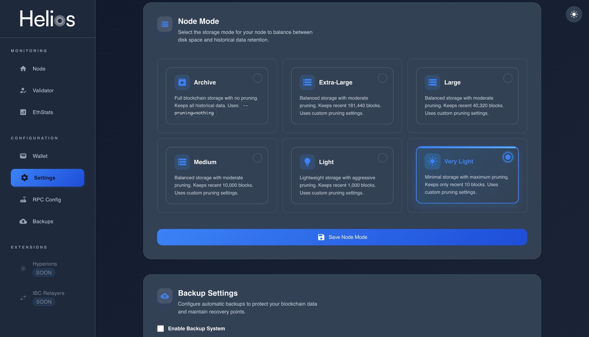
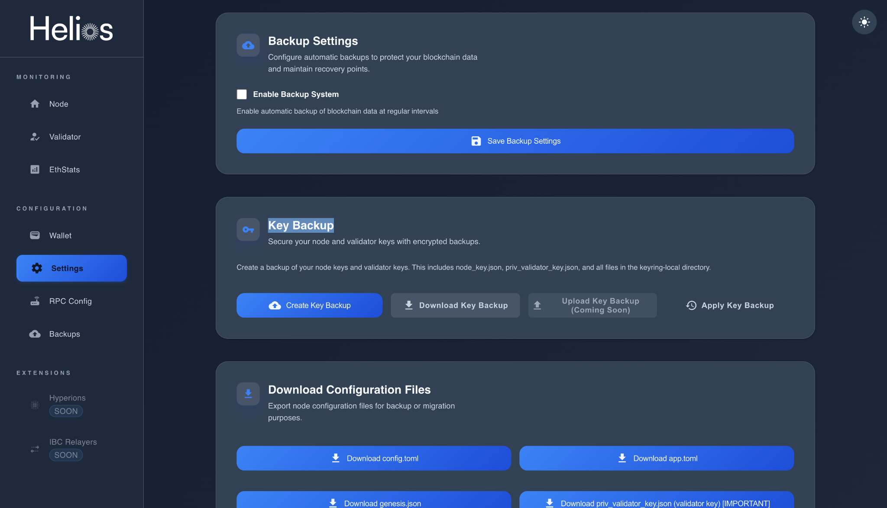
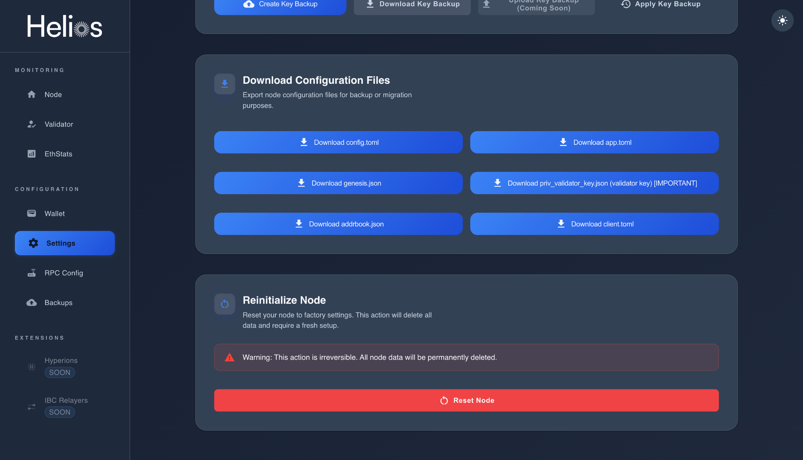
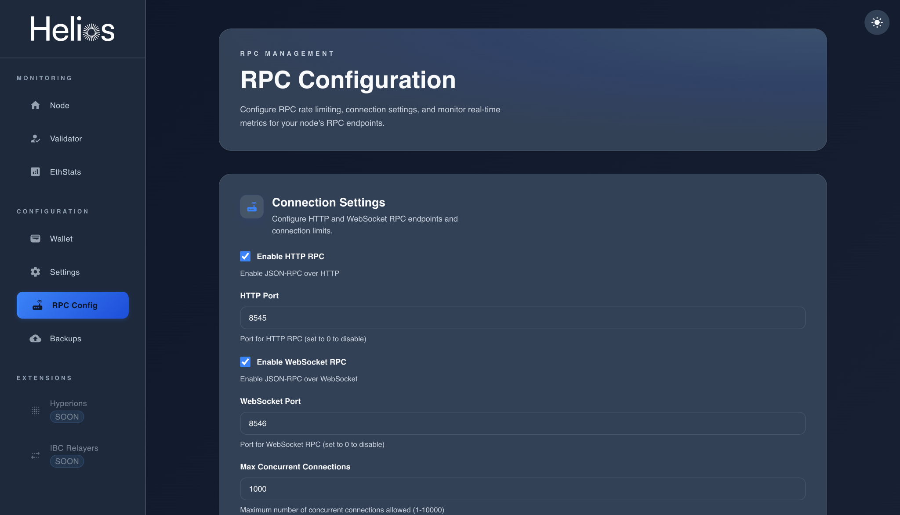
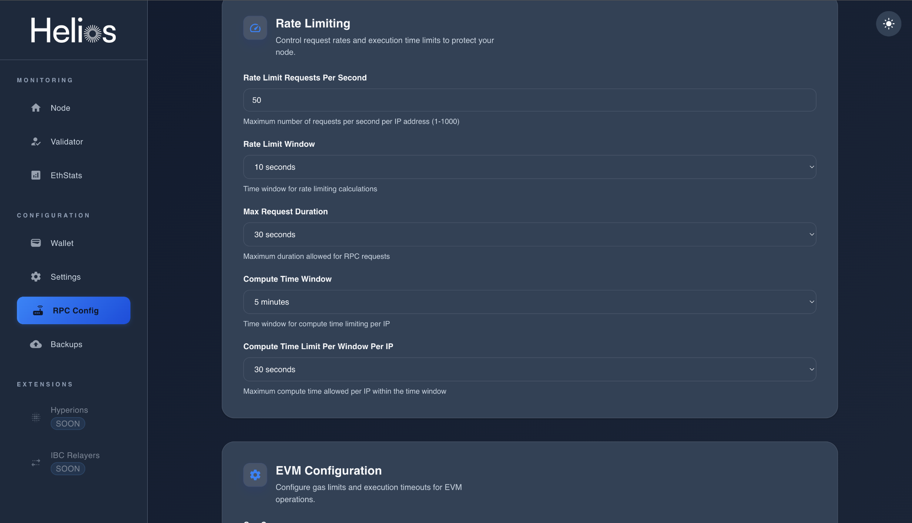
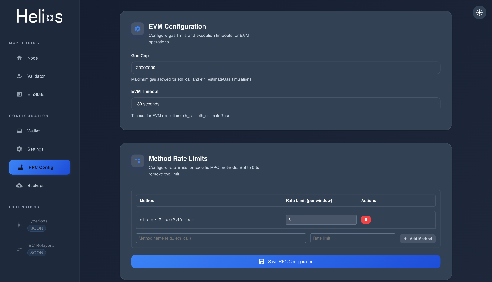
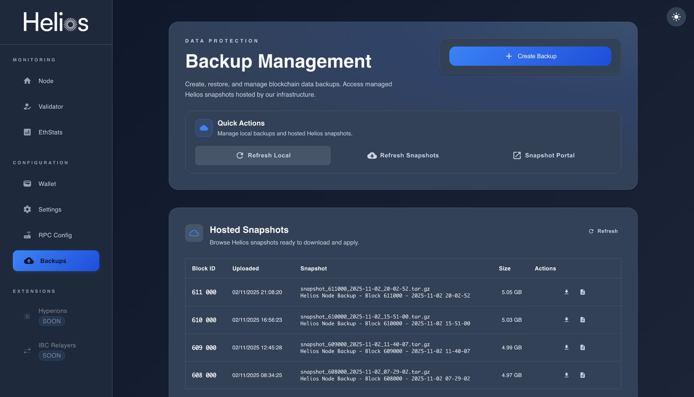

# Node Configuration Guide

This guide explains how to configure your Helios node using the integrated management interface.  
Through this section, you can manage logging options, pruning modes, RPC endpoints, backups, and key security.  

> ⚠️ **Important:** Always create and securely store a **Key Backup** as soon as possible. Losing your key means losing access to your validator permanently.

---

## 1. Accessing the Configuration Interface

Go to the **Settings** tab from the sidebar of your Helios dashboard.

From here, you can manage:
- **Logging and debug options**  
- **Node storage mode (Archive, Light, etc.)**  
- **Automatic backup system**  
- **RPC endpoint configuration**  
- **Key and validator backups**

---

## 2. Node Settings

Adjust log levels and debugging preferences for your node.

- **Enable Debug Execution Trace:** Activate detailed execution trace logs for advanced debugging.  
- **Log Level:** Choose between `Error`, `Warning`, or `Info` depending on how much detail you need in your logs.  
After modification, click **Save Settings** to apply changes.

---

## 3. Node Mode

Select the appropriate **storage mode** for your node to balance between disk usage and data retention.

| Mode | Description |
|------|--------------|
| **Archive** | Full blockchain storage with no pruning. Keeps all historical data. |
| **Extra-Large** | Keeps ~181,440 blocks. Balanced pruning for rich history. |
| **Large** | Keeps ~40,320 blocks with moderate pruning. |
| **Medium** | Keeps ~10,000 blocks with moderate pruning. |
| **Light** | Keeps ~1,000 blocks. Lightweight node mode. |
| **Very Light** | Keeps only ~10 blocks. Minimum disk usage, maximum pruning. |

Click **Save Node Mode** after selecting your preference.

---

## 4. Backup Settings

Configure automatic backups to protect your blockchain data.

- Enable **automatic backups** at intervals to avoid data loss.  
- You can also **create manual backups** of your node keys and validator keys.  
  These include:  
  - `node_key.json`  
  - `priv_validator_key.json`  
  - Files from `keyring-local` directory  

> 💾 **Recommendation:** As soon as your node is initialized, use the **Create Key Backup** button and download your encrypted key backup immediately.  
> Keep it safe — without this file, your validator cannot be recovered if the server is lost or reset.

---

## 5. Download Configuration Files

You can export node configuration files for migration or manual recovery.

Available files:
- `config.toml`
- `app.toml`
- `genesis.json`
- `priv_validator_key.json` (Validator key — **very important!**)
- `addrbook.json`
- `client.toml`

---

## 6. Reinitialize Node

If you need to reset your node to factory settings, use **Reinitialize Node**.

> ⚠️ **Warning:** This will permanently delete all node data and require a full reinstallation. Make sure all your keys and backups are saved before continuing.

---

## 7. RPC Configuration

Manage and customize your RPC endpoints, rate limits, and EVM execution settings.

### Connection Settings
- Enable or disable **HTTP RPC** and **WebSocket RPC**.  
- Configure custom ports (default: `8545` for HTTP, `8546` for WebSocket).  
- Limit the **maximum concurrent connections** (default: 1000).  

### Rate Limiting

- Limit requests per second per IP.  
- Define max request duration and compute time limits.  
These help protect your node from overuse or abuse.

### EVM Configuration

- Set a **Gas Cap** (default 20,000,000).  
- Define **EVM Timeout** for calls and simulations.  
- Optionally, apply **per-method rate limits** to restrict heavy RPC methods.

---

## 8. Backup Management

You can browse, download, and restore **Helios snapshots** directly from your dashboard.

- **Create Backup:** Generate a manual snapshot.  
- **Hosted Snapshots:** Download blockchain snapshots from the Helios network.  
- **Local Backups:** View and restore local snapshots.

---

## Final Recommendations

- ✅ Always save your **Key Backup** immediately after setup.  
- 🧩 Keep your node updated regularly using `helios install`.  
- 🔐 Enable automatic backups for maximum reliability.  
- ⚙️ Monitor your RPC settings to optimize performance and security.  
- 📊 Use “Archive” mode only if you have large storage available; “Light” or “Very Light” is ideal for smaller setups.
