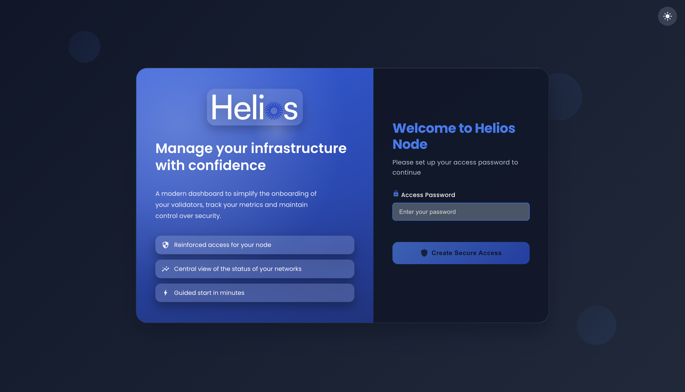
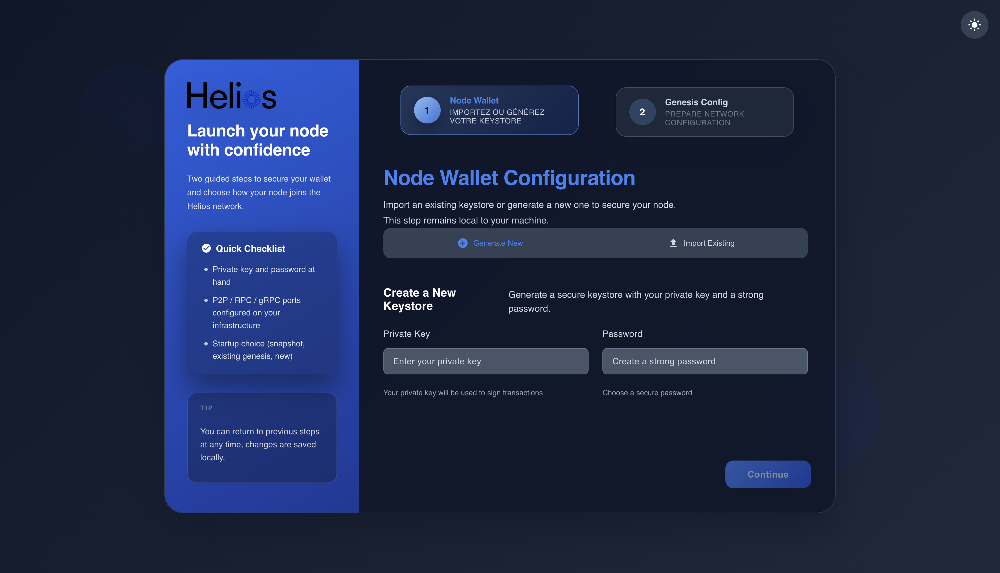
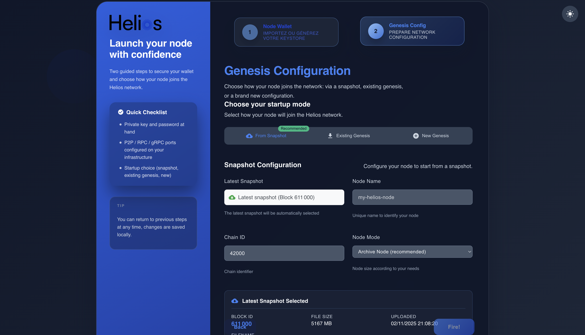
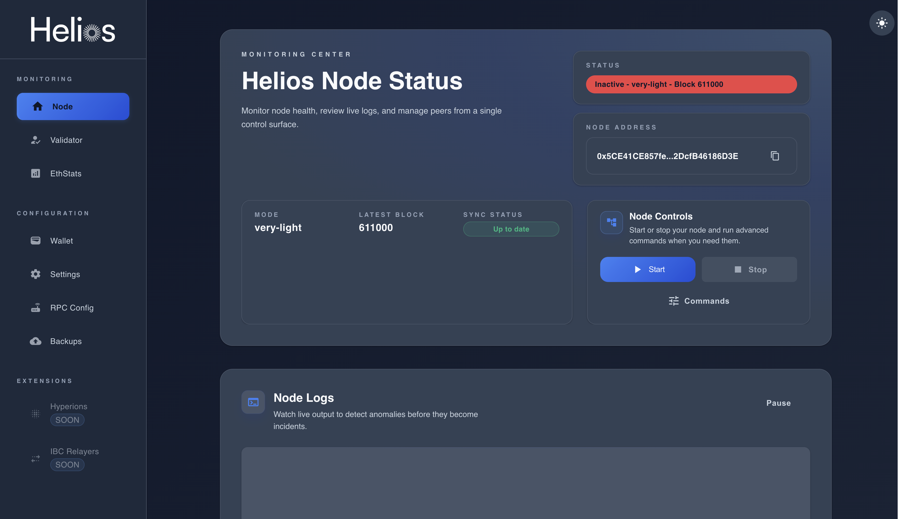

# Installation Guide

This guide explains how to install and set up a Helios node using **helios**, the command-line interface (CLI) for interacting with the Helios blockchain Docker container. Whether you are running a **validator**, **full node**, or **light node**, this guide will walk you through the setup.

---

## 1. Installing Helios CLI

Helios requires **Node.js v18.18.2**:

```sh
node -v
```

Expected output:

```
v18.18.2
```

Then install the Helios CLI:

```sh
npm install -g @helios-chain-labs/helios-cli
```

---

## 2. Installing the Helios blockchain container

```sh
helios install
```

Expected output:

```
✔ Installation successfully finished.
```

---

## 3. Running your Helios container

```sh
helios start
```

Expected output:

```
✔ docker-compose.yml generated successfully
✔ NodeManager started successfully. You can access it at http://0.0.0.0:8080
```

---

## 4. Configuring the node

Access the interface using your browser at: **http://your-ip:8080**



Define the password you want to use to secure access to your node.  
We recommend using **at least 15 characters** for better security.

After that, you will reach the setup page where you can **create a keystore** using the **secret key** of your future validator wallet.

This step encrypts your secret key with another password (minimum 15 characters recommended), which will be required to perform any sensitive action on your node after installation.



On the next page, you can **install the latest snapshot**, **define your node name**, and **select the desired node mode**.

> 💡 *Note:* The “Apply” step takes approximately **5–10 minutes** to decompress and install the snapshot.



Once completed, your node will be ready to start.



Now, click the **Start** button to begin synchronization.

When synchronization is complete, go to the **Validator** tab to create your validator.

---

## Final Notes

- For additional configurations (RPC, APIs, and network settings), see **[Configuring Your Node](./configuration.md)**.  
- Ensure your node is fully synchronized before participating in consensus.  
- Regularly monitor logs to troubleshoot potential issues.
