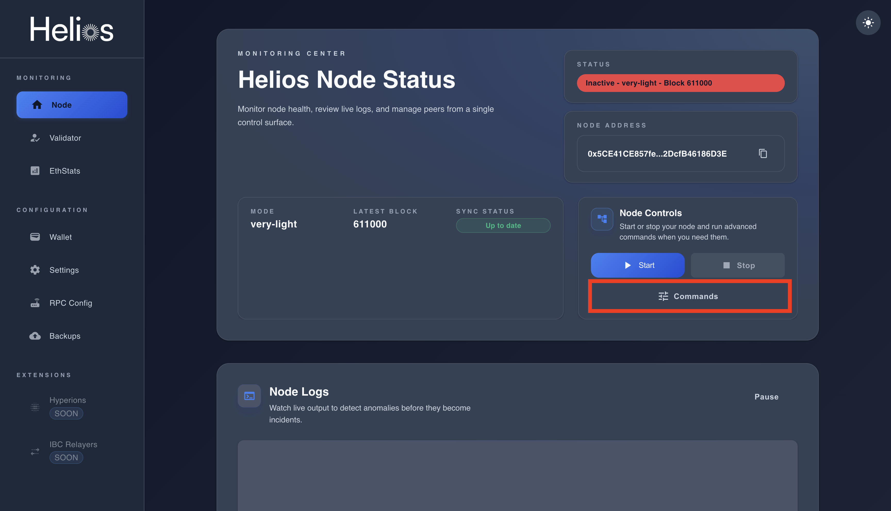
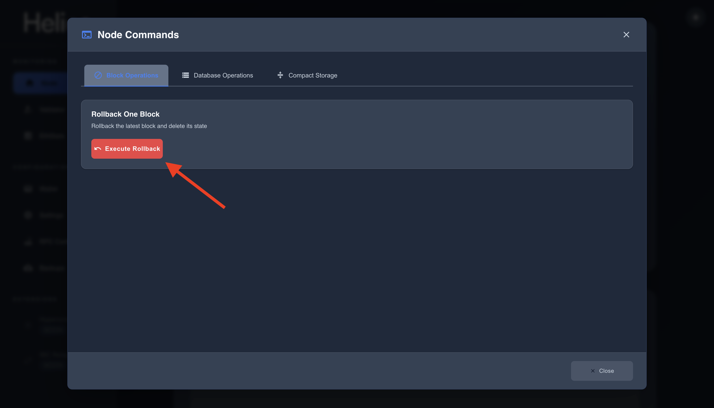

# Running & Maintaining

Proper maintenance ensures that your Helios node runs efficiently, stays synchronized with the network, and remains secure against threats. This guide covers essential maintenance tasks, upgrading procedures, and the additional steps required to run a validator node.

At the mainnet phase, the node will be able to update itself automatically.

But currently, after each update, your node may become locked or stuck on a specific block.

When this happens, go to your server or computer and run the following commands:

```sh
helios stop
helios install
helios start
```

Then go back to your management interface to start the node.

If the node remains stuck, follow these steps:

1. Stop your node.  
   
2. Click on **Commands**.  
   
3. Once finished, restart your node. It should now sync correctly.

---

## Conclusion

By maintaining and upgrading your node properly, you ensure:

- High uptime and better rewards.  
- Avoidance of penalties and slashing.  
- A secure and stable contribution to the Helios blockchain.
